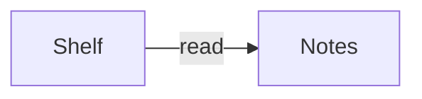

# Reading list

What I'm reading, and what I thought.^[projects/library/Notes.md:4-5]
This sentence follows a single newline.

See [[Authors]], [[Authors|the authors]], [[Authors#Living]], [[Authors#^favourite]], [[#Fiction]] and [[Missing note]].

Inline ==highlight==, ~~strike~~, **bold**, *italic*, `code with %% and ==`, a #tag, a #nested/tag, not tags: C# and #123, plus www.example.com. %%hidden inline comment%%

%%
A block comment
over two lines
%%

![[cover.png|300]]

![[Authors]]

![[Authors#Living]]

![[Authors#^favourite]]


[The authors note](Authors.md), [a heading](Authors.md#Living), [a section here](#Fiction) and [a site](https://example.com).

## Fiction

> [!note]
> A plain note callout.

> [!warning]- Collapsed warning with a **bold** title
> Body with a [[Authors|link]].
> > [!tip] Nested tip
> > Inside.

> [!faq]+ An alias type, open
> FAQ is an alias of question.

> [!library] A custom type
> Unknown types look like a note.

> A plain blockquote.

- parent
  - child with a 2-space indent
    - grandchild

- [ ] to read
- [x] read
- [/] reading
- [-] gave up

## Numbers

Inline math $e^{i\pi} + 1 = 0$, and money: it costs $5 and $10, which is not math.

$$
\int_0^\infty e^{-t}\,dt = 1
$$

```python
def rating(stars: int) -> str:
    return "★" * stars  # a comment
```

```unknownlang
plain <text> & more
```



```dataview
TABLE rating FROM #reading
```

| Title | Pages |
| :--- | ---: |
| Dune | 412 |
| Emma | 474 |

A paragraph with a block id. ^para-1

A footnote reference[^1] and an inline one^[Inline footnote text.].

[^1]: The footnote text.

<details><summary>HTML details</summary>Inside, **not markdown**.</details>

<kbd>Ctrl</kbd> + <kbd>C</kbd>

 <script>alert(2)</script> [bad link](javascript:alert(3)) <a href="https://example.com" onclick="alert(4)">ok link</a>

<span style="color: red; position: fixed; inset: 0">styled</span> <a id="katex" href="#">clobber</a> <iframe src="https://example.com"></iframe>
